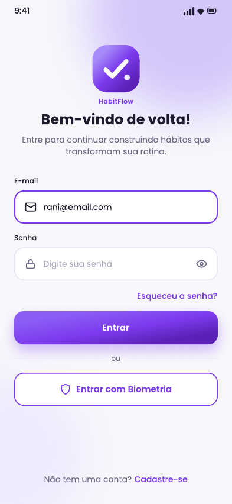
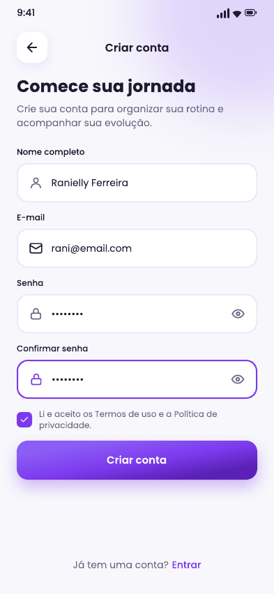
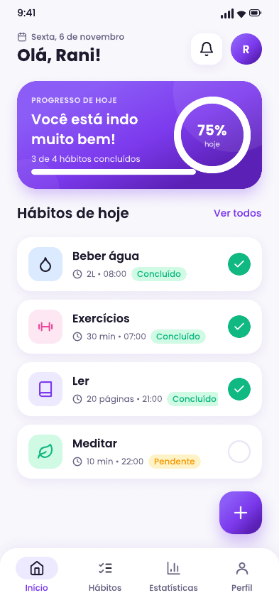
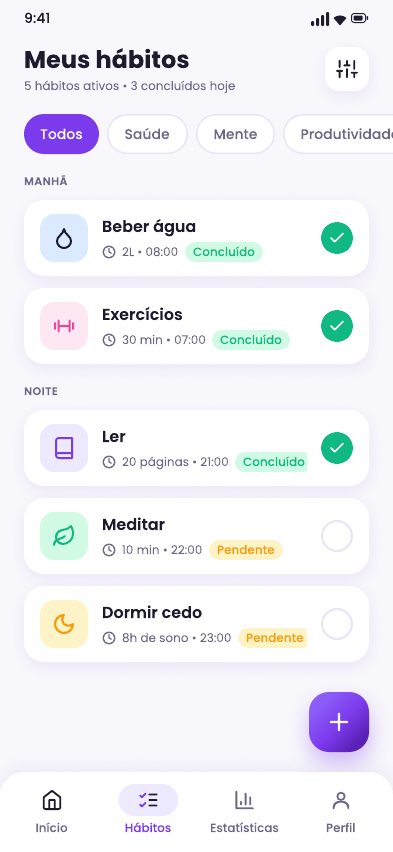
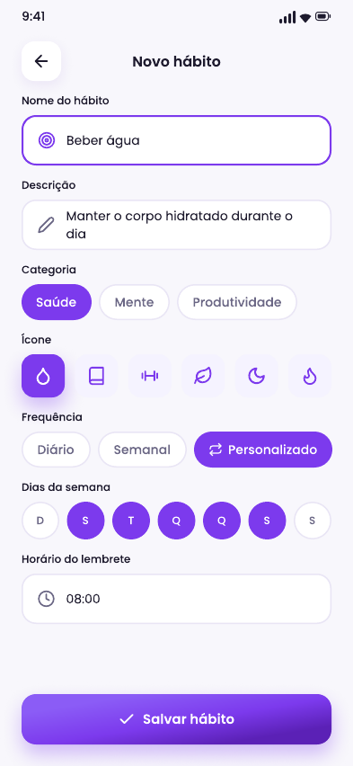
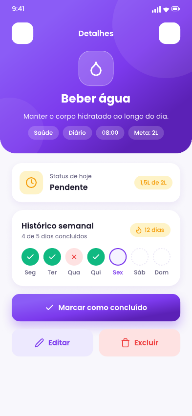
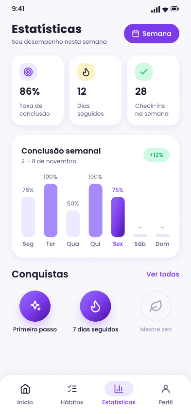

# HabitFlow — Controle de Hábitos

Aplicativo Android de **controle de hábitos** feito em **Kotlin + Jetpack Compose**, com arquitetura **MVVM** e login por **Firebase Authentication** (e-mail/senha). Depois de entrar, o usuário gerencia seus hábitos: cadastra, edita, vê detalhes, exclui e marca o **status diário (feito/não feito)**, que fica salvo no aparelho com **Jetpack DataStore**.

A interface segue o protótipo **HabitFlow** feito no Figma: tema roxo em gradiente, fonte Poppins, cards arredondados e barra de navegação inferior.

---
## 🎨 Video YouTube

**Link público:** https://youtu.be/F6znuIwXdWs

## 🎨 Protótipo no Figma

**Link público:** https://www.figma.com/design/qjp6fpOSHkG9OpYvTN38U4/habitos-saudaveis?node-id=2-5

O protótipo tem 8 telas: **Login**, **Criar conta**, **Início**, **Meus hábitos** (listagem), **Novo hábito** (cadastro/edição), **Detalhes**, **Estatísticas** e **Perfil**.

---

## 📸 Telas do protótipo (Figma)

<table align="center">
  <tr>
    <th>Login</th>
    <th>Criar conta</th>
    <th>Início</th>
    <th>Meus hábitos</th>
  </tr>
  <tr>
    <td align="center"></td>
    <td align="center"></td>
    <td align="center"></td>
    <td align="center"></td>
  </tr>
  <tr>
    <th>Novo hábito</th>
    <th>Detalhes</th>
    <th>Estatísticas</th>
    <th>Perfil</th>
  </tr>
  <tr>
    <td align="center"></td>
    <td align="center"></td>
    <td align="center"></td>
    <td align="center"></td>
  </tr>
</table>

---

## ✅ Funcionalidades

**Autenticação (Firebase)**
- **Login** com e-mail e senha, mostrar/ocultar senha e "Esqueceu a senha?" (envia o e-mail de redefinição).
- **Criar conta** com nome completo, e-mail, senha, confirmação e aceite obrigatório dos Termos de uso.
- **Entrar com Biometria**: depois do primeiro login com e-mail e senha, o app guarda as credenciais criptografadas (Android Keystore) e passa a liberá-las com a digital ou o rosto (`BiometricPrompt`).
- A sessão continua ativa entre aberturas do app. Depois do login o app abre o gerenciador de hábitos; depois do logout, volta para o login.

**Gerenciador de hábitos**
- **Início**: data, saudação ("Olá, Rani!"), card de progresso do dia com anel de porcentagem e lista dos **hábitos de hoje** com o check feito/não feito.
- **Meus hábitos** (listagem): contagem de hábitos ativos e de concluídos hoje, filtro por categoria (Todos/Saúde/Mente/Produtividade) e agrupamento por período (Manhã/Tarde/Noite).
- **Novo/Editar hábito** (cadastro/edição): nome, descrição, meta, categoria, ícone, frequência (Diário/Semanal/Personalizado), dias da semana e horário do lembrete.
- **Detalhes**: status de hoje, histórico semanal (concluído, perdido, hoje, futuro), sequência 🔥, marcar ou desfazer conclusão, editar e excluir.
- **Estatísticas**: taxa de conclusão da semana, dias seguidos, check-ins, gráfico de barras por dia, comparação com a semana anterior e conquistas.
- **Perfil**: avatar com iniciais, nome, e-mail, resumo (hábitos, % de conclusão, recorde), edição do nome (salvo no Firebase), redefinição de senha e sair da conta.

---

## 🏗️ Arquitetura MVVM

```
app/src/main/java/com/example/habits/
├── AppContainer.kt                 # Injeção de dependências manual + Application
├── MainActivity.kt                 # FragmentActivity (exigida pelo BiometricPrompt)
├── data/                           # ───────────── MODEL ─────────────
│   ├── model/
│   │   ├── Habit.kt                # Entidade + regras (programação, status diário, streak, recorde)
│   │   ├── HabitStats.kt           # Cálculos de progresso/estatísticas (funções puras)
│   │   └── AuthUser.kt             # Usuário autenticado (nome, iniciais), sem dependência do Firebase
│   └── repository/
│       ├── AuthRepository.kt             # Interface de autenticação
│       ├── FirebaseAuthRepository.kt     # Implementação com Firebase Auth
│       ├── HabitRepository.kt            # Interface de hábitos
│       ├── DataStoreHabitRepository.kt   # Implementação com DataStore (JSON por usuário)
│       └── CredentialStore.kt            # Credenciais criptografadas (Keystore) para a biometria
└── ui/                             # ──────── VIEW + VIEWMODEL ────────
    ├── navigation/HabitsApp.kt     # SessionViewModel, NavHosts e barra inferior
    ├── auth/        AuthViewModel.kt  + AuthScreens.kt        (Login, Criar conta)
    ├── home/        HomeViewModel.kt  + HomeScreen.kt         (Início)
    ├── habits/list/ HabitListViewModel.kt + HabitListScreen.kt (Meus hábitos)
    ├── habits/form/ HabitFormViewModel.kt + HabitFormScreen.kt (Novo/Editar hábito)
    ├── habits/detail/ HabitDetailViewModel.kt + HabitDetailScreen.kt (Detalhes)
    ├── stats/       StatsViewModel.kt + StatsScreen.kt        (Estatísticas)
    ├── profile/     ProfileViewModel.kt + ProfileScreen.kt    (Perfil)
    ├── components/  Componentes do design (campos, botões, chips, cards, cabeçalhos)
    └── theme/       Cores, tipografia (Poppins) e formas do protótipo
```

### Responsabilidades

| Camada | O que faz | Não faz |
|--------|-----------|---------|
| **Model** (`data/`) | Entidades (`Habit`, `AuthUser`), regras de negócio (quais dias o hábito está programado, status do dia, sequência, recorde, taxas) e repositórios que falam com Firebase, DataStore e Keystore. Expõe dados como `Flow`/`StateFlow`. | Não conhece Compose nem ViewModels. |
| **ViewModel** (`*ViewModel.kt`) | Recebe eventos da View, valida, chama os repositórios e publica um **estado imutável** (`AuthUiState`, `HomeUiState`, `HabitListUiState`, `HabitFormUiState`, `HabitDetailUiState`, `StatsUiState`, `ProfileUiState`) via `StateFlow`. Sobrevive a rotações de tela. | Não referencia composables. |
| **View** (`*Screen.kt`) | Composables que **apenas desenham o estado** e repassam eventos (lambdas) ao ViewModel. Cada tela tem um `*Route` (liga ViewModel → tela) e um `*Screen` sem estado (usado também nos `@Preview`). | Não guarda regra de negócio. |

### Fluxo de estados (unidirecional)

```
 ┌──────────── evento (clique, digitação) ────────────┐
 │                                                     ▼
View (Compose) ◄── StateFlow<UiState> ── ViewModel ── chama ──► Repository ──► DataStore / Firebase
      ▲              collectAsStateWithLifecycle()        ▲                         │
      └─────────────── recomposição ◄──────────────────────┴──── Flow com novos dados ◄┘
```

Exemplo: marcar um hábito como concluído
1. O usuário toca no círculo do card → a tela chama `onToggle(id)`.
2. O ViewModel chama `habitRepository.toggleCompletion(uid, id, hoje)`.
3. O `DataStoreHabitRepository` grava a lista atualizada e o `Flow` do DataStore emite de novo.
4. Os ViewModels de Início, Meus hábitos, Detalhes, Estatísticas e Perfil, que observam o mesmo `Flow`, recalculam seus estados com `map`/`combine` + `stateIn`.
5. As telas coletam o novo estado com `collectAsStateWithLifecycle()` e se redesenham: o check, o anel de progresso, o histórico e as estatísticas se atualizam sozinhos.

### Navegação e redirecionamento

`HabitsApp` observa `SessionViewModel.currentUser` (um `StateFlow<AuthUser?>` vindo do `AuthRepository`):
- `null` → `AuthNavHost` (rotas `login` e `register`);
- usuário logado → `MainNavHost` com a barra inferior (`home`, `habits`, `stats`, `profile`) e as telas `habit/form?id={id}` e `habit/detail/{id}`.

Quando o login dá certo, ninguém navega manualmente: o estado muda e a UI troca de fluxo. O mesmo vale para o logout.

---

## 🔐 Integração com o Firebase Authentication

- Dependências: `firebase-bom` + `firebase-auth`, e `kotlinx-coroutines-play-services` para usar `await()` nas `Task`s do Firebase.
- `FirebaseAuthRepository`:
  - `createUserWithEmailAndPassword` e, em seguida, `updateProfile` para salvar o **nome completo**;
  - `signInWithEmailAndPassword` para o login;
  - `sendPasswordResetEmail` para "Esqueceu a senha?" e para "Privacidade e segurança" no Perfil;
  - `updateProfile` para "Editar perfil";
  - `signOut` para "Sair da conta";
  - um **`AuthStateListener`** que mantém o `StateFlow<AuthUser?>` atualizado. Como o Firebase guarda a sessão, o usuário continua logado ao reabrir o app.
- Os erros do Firebase viram mensagens em português (e-mail já cadastrado, senha fraca, credenciais inválidas, sem internet, muitas tentativas).
- Antes de chamar o Firebase, o `AuthValidator` verifica: e-mail válido, senha com pelo menos 6 caracteres, confirmação igual, nome preenchido e termos aceitos.
- O plugin `com.google.gms.google-services` só é aplicado se `app/google-services.json` existir. Sem o arquivo o projeto **compila mesmo assim**, e a tela de login mostra "Firebase não configurado".

### Configurar o Firebase (uma vez)

1. Acesse https://console.firebase.google.com e crie um projeto.
2. Clique em **Adicionar app → Android** com o pacote **`com.example.habits`**.
3. Baixe o **`google-services.json`** e coloque em **`app/google-services.json`**.
4. No console: **Authentication → Sign-in method → E-mail/senha → Ativar**.

---

## ▶️ Build e execução

**Requisitos:** Android Studio recente (AGP 9.x), JDK 21 (o JBR que vem com o Android Studio serve), Android SDK 37 instalado e um emulador ou aparelho com **Android 8.0 (API 26) ou superior** e Google Play Services.

```bash
git clone <url-do-repositorio>
cd Habits
# coloque o google-services.json em app/ (ver seção acima)
```

**Pelo Android Studio:** *File → Open* → selecione a pasta → aguarde o Gradle Sync → escolha o dispositivo → **Run ▶**.

**Pela linha de comando:**

```bash
./gradlew assembleDebug        # gera app/build/outputs/apk/debug/app-debug.apk
./gradlew installDebug         # instala no emulador/dispositivo conectado
./gradlew testDebugUnitTest    # testes unitários (regras do hábito, estatísticas e validação)
```

No Windows use `gradlew.bat` no lugar de `./gradlew`.

**Biometria no emulador:** em *Settings → Security → Fingerprint* cadastre uma digital e use *Extended controls → Fingerprint → Touch sensor* para simular o toque. Antes disso, entre uma vez com e-mail e senha.

---

## 🧰 Tecnologias

Kotlin · Jetpack Compose (Material 3) · ViewModel + StateFlow · Navigation Compose · DataStore Preferences · Firebase Authentication · AndroidX Biometric + Android Keystore · Coroutines/Flow · Poppins (Google Fonts, OFL) · JUnit
